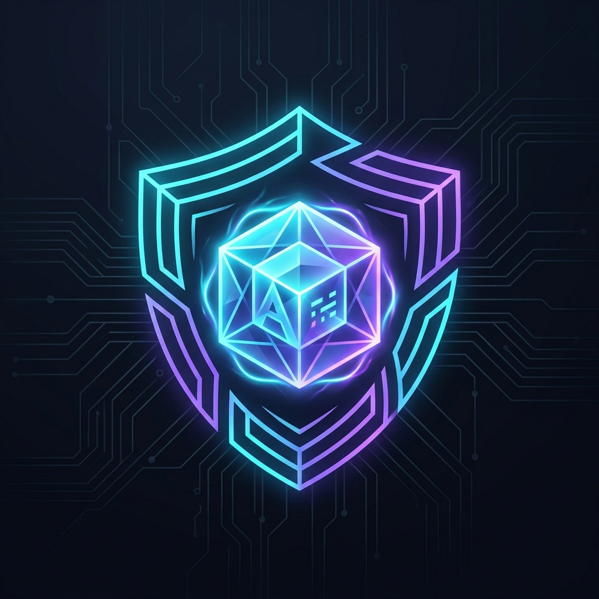

<div align="center">



# 🛡️ Antigravity Chat Guardian
### The Ultimate History Recovery, Live Auto-Backup & Local Viewer for Google Antigravity IDE

[](https://www.python.org/)
[]()
[](LICENSE)
[](https://github.com)
[](https://antigravity.google)
[](CONTRIBUTING.md)
[]()
[](#-support--donations)

<br>

<p align="center">
  <b>Built For & Fully Compatible With</b><br>
  
  
  
  
  
  
</p>

<p align="center">
  <b>Never lose your AI pair-programming conversations again.</b><br>
  Antigravity Chat Guardian rescues lost chats from corrupted <code>state.vscdb</code> indexes, automatically backs up sessions in real time without CPU overhead, and provides an offline local web viewer.
</p>

[English Overview](#-the-problem) • [Guía en Español](#-guía-rápida-en-español) • [Installation Guide](#-installation--setup-guide) • [Architecture](#-architecture) • [CLI Reference](#-cli-reference) • [FAQ](#-frequently-asked-questions)

</div>

---

## 🔍 The Problem

Developers using **Google Antigravity IDE** (based on VS Code OSS) frequently face sudden conversation loss:
1. **Workspace Switching Disconnection:** Switching between projects or folders causes past chat sessions to vanish from the native chat sidebar.
2. **Database Index Resets:** Upon IDE restarts, crashes, or ungraceful exits, `state.vscdb` resets `chat.ChatSessionStore.index` to `{}` or desynchronizes Protobuf `trajectorySummaries`.
3. **The Data is Not Lost:** The underlying conversation databases (`.db` / `.pb`) and transcripts (`transcript_full.jsonl`) remain safely preserved inside `~/.gemini/antigravity-ide/`. The IDE simply cannot find them due to strict URI path filters and desynchronized internal index tables.

## 🚀 The Solution: Antigravity Chat Guardian

**Antigravity Chat Guardian** operates directly at the SQLite and Protobuf layer:
- **🔄 Master 1-Click Restoration:** Re-injects all existing conversations back into Antigravity IDE's native sidebar, perfectly mapped to their original project workspaces.
- **⚡ Smart Conditional Watcher:** An ultra-lightweight background daemon that **sleeps at 0.0% CPU** when Antigravity IDE is closed, and automatically awakens to capture steps in real-time when the IDE process is detected via native Win32 `ctypes` (<3ms check).
- **🛡️ Auto-Immunization:** Automatically repairs and synchronizes `state.vscdb` indexes whenever Antigravity IDE closes, preventing future session loss.
- **🌐 Offline Web Control Hub:** A standalone dark-mode web application (`http://127.0.0.1:7890`) to search, read, filter, and inspect messages across all projects.
- **🩺 Built-in System Doctor (`cli.py doctor`):** Instant diagnosis of IDE storage health, physical file count vs. visible sessions.
- **📤 Multi-format Exporter:** Export any conversation to formatted Markdown or structured JSON.
- **🔒 100% Privacy & Zero Cloud:** Runs completely offline with Python's standard library. Zero telemetry, zero external servers.

---

## 📦 Installation & Setup Guide

### Prerequisites
* **Operating System:** Windows 10 or Windows 11 (64-bit).
* **Python:** Python 3.10 or higher. *(Make sure to check "Add Python to PATH" during installation).*
* **IDE:** Google Antigravity IDE (v2.0 – v2.5.5+).

---

### Method 1: 1-Click Setup (Recommended for Windows Users)

1. **Download / Clone this Repository:**
   ```bash
   git clone https://github.com/your-username/antigravity-chat-guardian.git
   cd antigravity-chat-guardian
   ```
   *(Or download the ZIP file from GitHub and extract it to any folder).*

2. **Run the Installer:**
   Double-click **`setup.bat`**.  
   *It will verify your Python environment, scan your Antigravity IDE installation, and run an initial integrity check.*

3. **Start Protecting & Restoring:**
   * **To restore all past chats into the IDE sidebar:** Double-click `restaurar_historial_antigravity.bat`.
   * **To activate silent background auto-backup:** Double-click `iniciar_vigilante_silencioso.vbs`.
   * **To browse all chats in the offline Web Viewer:** Double-click `run_hub.bat`.

---

### Method 2: Manual Terminal / CLI Setup

1. **Verify System Integrity:**
   ```bash
   python cli.py doctor
   ```
   *This command inspects your physical files, index tables, and gives you actionable recommendations.*

2. **Sync Existing Conversations into Secure Local DB:**
   ```bash
   python cli.py sync
   ```

3. **Inject History back into Antigravity IDE:**
   ```bash
   python cli.py restore-all --force
   ```

4. **Launch the Web Viewer (Port 7890):**
   ```bash
   python cli.py serve
   ```
   *Open your browser at `http://127.0.0.1:7890`.*

---

## 🏗️ Architecture

```
antigravity-chat-guardian/
├── assets/
│   └── logo.png                          # High-tech project branding
├── backups/                              # Local isolated data vault (.gitignored)
│   └── antigravity_history.db            # Centralized indexed SQLite store
├── src/
│   ├── core/
│   │   ├── paths.py                      # Dynamic Antigravity & Windows path resolver
│   │   ├── protobuf.py                   # Wire Type 0 & 2 Protobuf encoder/patcher
│   │   ├── db_scanner.py                 # Non-destructive SQLite metadata reader
│   │   ├── doctor.py                     # Health diagnostics & integrity checker
│   │   └── exporter.py                   # Markdown & JSON export engine
│   ├── backup/
│   │   ├── db.py                         # Unified schema & WAL connection manager
│   │   ├── extractor.py                  # Step parser for .db, .pb and jsonl transcripts
│   │   └── watcher.py                    # Ctypes Windows process watcher & auto-repair
│   ├── recovery/
│   │   ├── restorer.py                   # Atomic state.vscdb session re-binder
│   │   └── restore_all.py                # Multi-project bulk workspace injector
│   └── viewer/
│       ├── server.py                     # Zero-dependency Python HTTP API server
│       └── web/                          # Modern Dark-Mode Single Page Application
│           ├── index.html
│           ├── styles.css
│           └── app.js
├── cli.py                                # Master Command Line Interface
├── setup.bat                             # 1-Click installer and doctor launcher
├── restaurar_historial_antigravity.bat   # 1-Click sidebar restorer
├── iniciar_vigilante_silencioso.vbs      # Silent background protection launcher
├── detener_vigilante.bat                 # Background watcher stopper
└── run_hub.bat                           # 1-Click Web Viewer launcher
```

### Deep Dive: How the Sidebar Injection Works
Antigravity IDE stores state in `%APPDATA%\Antigravity IDE\User\globalStorage\state.vscdb`:
1. **`chat.ChatSessionStore.index`**: JSON dictionary containing session metadata (`sessionId`, `customTitle`, `creationDate`).
2. **`antigravityUnifiedStateSync.trajectorySummaries`**: Base64-encoded Protobuf wire stream containing repeated messages with Field 9 (`workspace_uri`) and Field 17 (`repository_id`).

When restoring, **Guardian** safely creates a timestamped backup of `state.vscdb`, reads physical step history, maps each conversation to its directory path (`file:///d:/...`), and encodes valid Protobuf entries so Antigravity renders them immediately upon startup.

---

## 💻 CLI Reference

| Command | Arguments | Description |
|---|---|---|
| `python cli.py doctor` | — | Runs deep diagnostics on IDE health, missing chats, and indexes |
| `python cli.py status` | — | Shows conversation counts, steps, and mapped projects |
| `python cli.py sync` | — | Extracts and backups all conversations from disk into local DB |
| `python cli.py watch` | — | Starts the smart conditional background watcher |
| `python cli.py restore-all` | `--force` | Injects all historical conversations back into Antigravity IDE |
| `python cli.py restore` | `<id> --workspace <uri>` | Rebinds a specific conversation to a specific folder |
| `python cli.py serve` | `--port 7890` | Starts the local web viewer & search hub |
| `python cli.py export` | `<id> --format md\|json` | Exports a conversation to Markdown or JSON |

---

## 🇪🇸 Guía Rápida en Español

### ¿Qué hace esta herramienta?
Soluciona de forma definitiva el problema donde **Google Antigravity IDE** "olvida" o borra las conversaciones al cambiar de proyecto o cerrar el programa:
1. **Restaura todo tu historial:** Inyecta tus conversaciones viejas y nuevas para que vuelvan a aparecer en la barra lateral del chat de Antigravity al abrir cada proyecto.
2. **Vigilante Inteligente:** Un servicio silencioso en segundo plano que consume **0% de procesador** cuando Antigravity está cerrado, y respalda en tiempo real cada mensaje cuando estás trabajando.
3. **Auto-Reparación:** Al cerrar Antigravity, repara automáticamente el archivo `state.vscdb` para que el IDE nunca más vuelva a vaciar tu historial.
4. **Visor Web Local:** Un panel visual en tu navegador (`http://127.0.0.1:7890`) para leer y buscar en todas tus conversaciones históricas sin depender del IDE.

### Instalación y Uso en 1 Clic
1. Descarga el proyecto o clónalo con `git clone`.
2. Haz doble clic en **`setup.bat`** para comprobar que tu sistema está listo.
3. Elige qué deseas hacer:
   - **`restaurar_historial_antigravity.bat`**: Restaura de inmediato todas tus conversaciones en la barra lateral del IDE.
   - **`iniciar_vigilante_silencioso.vbs`**: Activa la protección automática en segundo plano (sin ventanas ni terminales).
   - **`run_hub.bat`**: Abre el visor web interactivo en tu navegador.

---

## ❓ Frequently Asked Questions (FAQ)

<details>
<summary><b>Will this consume my CPU or slow down my computer?</b></summary>
<br>
No. The background watcher uses native Windows <code>ctypes</code> calls to check whether Antigravity is running in under 3 milliseconds. When the IDE is closed, it enters deep sleep mode with 0.0% CPU usage.
</details>

<details>
<summary><b>Are my conversations or API keys sent to the internet?</b></summary>
<br>
Never. Antigravity Chat Guardian is 100% offline, local-only, and open-source. It contains zero network calls and zero external dependencies.
</details>

<details>
<summary><b>Can I export my conversations to share with colleagues or notes?</b></summary>
<br>
Yes! Use <code>python cli.py export &lt;conversation_id&gt; --format md</code> to generate a beautifully formatted Markdown transcript.
</details>

---

## 🔒 Privacy & Security

- **Zero Cloud / Zero Telemetry:** Antigravity Chat Guardian never makes external network requests.
- **Data Isolation:** All personal chats, transcripts, and database backups are placed in `backups/`, strictly ignored by `.gitignore`.
- **Safe Reversible Backups:** Every modification to `state.vscdb` automatically creates a safety backup before writing.

## ☕ Support & Donations

If **Antigravity Chat Guardian** helped you rescue lost conversations or saved you valuable development hours, consider buying a coffee or donating to support maintenance and future updates:

<div align="center">


<br><br>

[](https://binance.com)

<p>
  <b>Binance UID:</b> <code>212227749</code><br>
  <i>(Scan QR with Binance app or transfer directly to UID with zero fees • USDT / BNB / BTC)</i>
</p>

</div>

---

## 🤝 Contributing

Contributions are welcome! Please check [CONTRIBUTING.md](CONTRIBUTING.md) for details on submitting issues and pull requests.

## 📄 License

This project is licensed under the [MIT License](LICENSE) - see the LICENSE file for details.
